# Anna Ermak — `Python Backend Developer`

> Building reliable applications. Exploring modern technologies. Growing every day.

  
  

**Open to Work | Internships | Volunteering | Freelance | Full-time**

---

## About Me

I'm Anna, a Python Developer passionate about backend development and building useful, reliable applications.

I enjoy working with Python, designing REST APIs, developing backend services, and working with databases.

- Focused on Python backend development.
- Working with Django and FastAPI.
- Interested in database design and API architecture.
- Actively exploring modern technologies, emerging tools, and new approaches to software development.
- Continuously expanding my technical knowledge and improving my development skills.
- Constantly learning, experimenting, and building new projects.
- Open to collaborations and professional opportunities.

**I'm open to any work opportunities where I can contribute, grow, learn new technologies, and build something meaningful!**

---

## Tech Stack

- **Languages**: Python, SQL

- **Backend Development**: Django, Django REST Framework, FastAPI, REST API

- **Databases & Caching**: PostgreSQL, SQLite, Redis

- **Task Queues & Message Brokers**: Celery, RabbitMQ

- **API & Authentication**: JWT, SimpleJWT, Swagger, ReDoc

- **Testing & Code Quality**: pytest, Ruff

- **DevOps & Infrastructure**: Docker, Docker Compose, Gunicorn, GitHub Actions, CI/CD

- **Tools**: Git, GitHub, Postman, VS Code, Linux

---

## Current Focus

Currently focused on:

- Improving Python skills and writing clean, maintainable code.
- Exploring modern backend architecture.
- Developing REST APIs and backend services.
- Learning more about asynchronous processing with Celery.
- Exploring message brokers and distributed systems.
- Improving database design and query optimization.
- Discovering new technologies and development tools.

---

## Featured Projects

Here are some projects I'm working on and developing:

| Project | Description | Technologies |
| ------- | ----------- | ------------ |
| [Task Manager](https://github.com/adsetsuko0/task_manager) | A task management application with project organization, task tracking, JWT authentication, REST API, and an interactive dashboard. | Python, Django, Django REST Framework, PostgreSQL, SQLite, Docker, pytest |
| [AI Digest](https://github.com/adsetsuko0/ai-digest) | A personal RSS news digest API with user authentication, RSS feed subscriptions, feed management, and rate limiting. LLM-powered summaries are planned. | Python, FastAPI, PostgreSQL, SQLAlchemy, Redis, Alembic, Docker, pytest |
| Project 3 | Coming soon... | Python, PostgreSQL |

---

## Currently Learning & Exploring

- Advanced Python development.
- Modern backend architecture and best practices.
- Asynchronous programming and task processing.
- Redis, Celery, and RabbitMQ.
- Distributed systems and scalable applications.
- API performance and optimization.
- Testing strategies and code quality.
- DevOps practices and CI/CD automation.

---

## Contribution Graph

  <picture>
    <source media="(prefers-color-scheme: dark)" srcset="https://raw.githubusercontent.com/adsetsuko0/adsetsuko0/output/pacman-contribution-graph-dark.svg">
    <source media="(prefers-color-scheme: light)" srcset="https://raw.githubusercontent.com/adsetsuko0/adsetsuko0/output/pacman-contribution-graph.svg">
    
  </picture>

---

## GitHub Activity

  

  

--- 

## Let's Connect

I'm always open to interesting projects, collaborations, internships, and new professional opportunities.

- **Email:** [anna.ermak.dev@gmail.com](mailto:anna.ermak.dev@gmail.com)
- **LinkedIn:** [linkedin.com/in/anna-ermak-b3a458363](https://www.linkedin.com/in/anna-ermak-b3a458363/)
- **Telegram:** [@satoset](https://t.me/satoset)
- **GitHub:** [@adsetsuko0](https://github.com/adsetsuko0)

---

  Thanks for visiting my profile!

